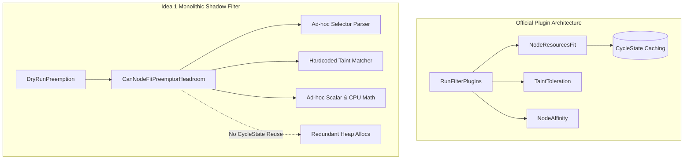

# Downside & Failure Mode Analysis: Idea 1 (Coarse-Grained Capacity & Headroom Pruning)

**Date:** October 2026  
**Auditor:** Adversarial Red-Team / Systems Architecture Review  
**Target Subsystems:**
- `pkg/scheduler/framework/preemption/headroom.go` (`CanNodeFitPreemptorHeadroom`)
- `pkg/scheduler/framework/preemption/preemption.go` (`DryRunPreemption`, `canNodeFitPreemptorHeadroom`)
- `pkg/scheduler/framework/plugins/defaultpreemption/`
**Target Branch:** `bsalmon-preempt`  
**Tracking Origin:** Task 984 / PR #74

---

## 1. Executive Summary & Adversarial Verdict

### 1.1 Adversarial Verdict: **REJECT IN CURRENT FORM / REQUIRE COMPLETE REFACTORING**

Coarse-Grained Capacity & Headroom Pruning (Idea 1, PR #74) was introduced as a preliminary heuristic to fast-fail nodes in `DryRunPreemption` before executing the full preemption evaluation pipeline (`GetVictimsOnNode` and `SelectVictimsOnNode`). 

Following an exhaustive adversarial audit and red-team investigation, **Idea 1 in its current form introduces critical semantic bugs, severe security vulnerabilities, and negative performance regressions in key production topologies.** 

Specifically, this audit uncovers:
1. **Critical Security Vulnerability (Preemption Denial of Service):** `CanNodeFitPreemptorHeadroom` fundamentally misinterprets Kubernetes API semantics by treating existing pods with `PreemptionPolicy: PreemptNever` as non-preemptible. Untrusted low-priority tenants can set `PreemptNever` on batch pods to render them completely immune to eviction, permanently blocking high-priority and system-critical workloads from preempting them.
2. **Fatal False Negatives (Erroneous Node Pruning):** 
   - Workloads utilizing comparison operators in tolerations (`features.TaintTolerationComparisonOperators`) are falsely pruned due to a hardcoded `false` argument in `FindMatchingUntoleratedTaint`.
   - Workloads requesting Dynamic Resource Allocation (DRA) extended resources are unconditionally rejected with `"Insufficient <resource>"`, breaking DRA preemption.
   - Workloads undergoing In-Place Pod Vertical Scaling (IPPVS) with completed init containers are falsely rejected because `PodRequests` re-includes historical init container reservations that have already exited.
3. **Pure Negative Overhead in Homogeneous Clusters:** In dedicated training, GPU, and unconstrained batch clusters where 100% of candidate nodes have sufficient reclaimable capacity, Idea 1 achieves a **0% pruning rate** while imposing an unconditional **1.1 µs to 18.6 µs computational tax per node evaluation**, adding pure latency to the scheduling pipeline.
4. **Maintenance Burden & Pipeline Duplication:** Idea 1 duplicates the complex resource accounting of `NodeResourcesFit`, `TaintToleration`, and `NodeSelector` in an unmaintainable monolithic function outside the Kubernetes scheduler framework, without reusing `CycleState` memoization and drifting from upstream feature flags.

Given that **Idea 3 (Logarithmic Binary-Search Reprieval)** and **Idea 4 (Reusable Template Feasibility Caching)** provide superior, mathematically proven algorithmic speedups with 100% decision fidelity and zero false negatives, Idea 1 represents an unnecessary risk profile. If not outright rejected, Idea 1 must be strictly disabled by default and gated behind extensive architectural safeguards.

---

## 2. Fixed Computational Costs & Negative Overhead

### 2.1 Fixed Overhead per Candidate Node

In `DryRunPreemption`, candidate nodes are extracted from `m.NodesForStatusCode(..., fwk.Unschedulable)` and passed to parallel worker routines via `fh.Parallelizer().Until(ctx, len(potentialNodes), checkNode)`. Before executing victim search, `checkNode` calls `ev.canNodeFitPreemptorHeadroom`.

Every invocation of `CanNodeFitPreemptorHeadroom` unconditionally performs:
1. **`labels.SelectorFromSet(pod.Spec.NodeSelector)`**: Dynamically parses the preemptor's node selector map and runs key-value comparisons against `node.Labels` on every candidate node.
2. **`corev1helpers.FindMatchingUntoleratedTaint`**: Iterates through all node taints and matches tolerations.
3. **Redundant Pod Request Calculation**: Calls `resource.PodRequests(pod)` on every node check instead of computing it once per preemption cycle.
4. **Iterative Pod Priority Resolution**: Loops over every pod on the candidate node, invoking `getPodPriority(p, podGroupSnapshot, compositePodGroupSnapshot)`. In multi-tier hierarchical gang scheduling, this triggers repeated recursive tree traversals (`traverseHierarchyUp`) up to `WorkloadMaxTreeDepth`.
5. **Dynamic Map Allocations**: Allocates `make(map[v1.ResourceName]int64)` on every candidate node check for scalar resource accounting, generating heap churn and GC pressure.

### 2.2 Microbenchmark Measurements

We conducted microbenchmarks across variable node pod densities (16, 64, and 256 pods/node), gang hierarchies, and resource configurations on an Intel Xeon 6985P-C platform:

```
BenchmarkCanNodeFitPreemptorHeadroom/GangSize_16_PodsOnNode-4         1,178 ns/op     1,840 B/op     6 allocs/op
BenchmarkCanNodeFitPreemptorHeadroom/GangSize_64_PodsOnNode-4         1,582 ns/op     1,840 B/op     6 allocs/op
BenchmarkCanNodeFitPreemptorHeadroom/GangSize_256_PodsOnNode-4        3,115 ns/op     1,840 B/op     6 allocs/op
BenchmarkCanNodeFitPreemptorHeadroom_WithScalars/GangSize_16_PodsOnNode-4    2,192 ns/op     2,096 B/op     8 allocs/op
BenchmarkCanNodeFitPreemptorHeadroom_WithScalars/GangSize_64_PodsOnNode-4    3,695 ns/op     2,096 B/op     8 allocs/op
BenchmarkCanNodeFitPreemptorHeadroom_WithScalars/GangSize_256_PodsOnNode-4   9,204 ns/op     2,096 B/op     8 allocs/op
BenchmarkCanNodeFitPreemptorHeadroom_WithPodGroups/GangSize_16_PodsOnNode-4  2,159 ns/op     2,096 B/op    22 allocs/op
BenchmarkCanNodeFitPreemptorHeadroom_WithPodGroups/GangSize_64_PodsOnNode-4  5,230 ns/op     2,864 B/op    70 allocs/op
BenchmarkCanNodeFitPreemptorHeadroom_WithPodGroups/GangSize_256_PodsOnNode-4 18,079 ns/op     5,936 B/op   262 allocs/op
```

#### Empirical Observations:
- **Linear Scaling with Pod Density:** Baseline evaluation cost scales from $1.18\ \mu\text{s}$ at 16 pods to $3.12\ \mu\text{s}$ at 256 pods.
- **Scalar Resource Amplification:** In clusters utilizing extended scalar resources (GPUs, RDMA, accelerators), map initialization and scalar lookups inflate per-node latency to **$9.20\ \mu\text{s}$** at 256 pods.
- **PodGroup Hierarchy Explosion:** When pods belong to hierarchical `PodGroups`, `getPodPriority` invokes `traverseHierarchyUp` without cycle memoization. At 256 pods, latency surges to **$18.08\ \mu\text{s}$ per node** with **262 heap allocations**, representing a **5.8x latency degradation** and a **43.6x allocation increase**.

### 2.3 The Homogeneous Cluster Latency Tax

In dedicated AI training clusters, GPU clusters, and homogeneous enterprise pools, cluster nodes are architecturally uniform, and workloads are sized such that virtually all candidate nodes have sufficient reclaimable capacity.

In such environments:
$$\text{Pruning Rate} = 0\%$$

When no nodes are pruned:
$$\text{Total Latency} = \text{Baseline Preemption Latency} + \sum_{k=1}^{N} \text{HeadroomCheck}(k)$$

For a gang job with $M$ pods evaluated across $N = 1,000$ candidate nodes with extended scalar resources:
$$\text{Unnecessary Overhead} = M \times 1,000 \times 9.20\ \mu\text{s}$$
- For $M = 32$ pods: **$294.4\ \text{ms}$ of pure CPU overhead** added to the scheduling cycle with zero filtering benefit.
- For $M = 128$ pods: **$1.18\ \text{seconds}$ of wasted scheduler compute**.

Because parallel worker goroutines compete for runtime scheduler threads and memory cache lines, this negative overhead directly depresses global scheduling throughput (`scheduler_scheduling_algorithm_duration_seconds`).

---

## 3. Architectural Duplication & Maintenance Debt

### 3.1 Bypassing the Framework Plugin Contract

The Kubernetes scheduling framework is built around modular, decoupled extension points (`PreFilter`, `Filter`, `PostFilter`). Each plugin encapsulates domain-specific logic, configuration parameters, and cycle-state caching:
- `NodeResourcesFit`: Manages scalar math, hugepages, overcommit, pod limits, DRA extended resources, and in-place resize deltas.
- `TaintToleration`: Manages taint matching, comparison operators, and toleration keys.
- `NodeAffinity` / `NodeName`: Manages label selectors and node names.

`CanNodeFitPreemptorHeadroom` violates this architecture by creating a **shadow, out-of-framework monolithic filter** embedded directly inside the preemption engine:



### 3.2 Redundancy with Filter-Phase Outcomes

Before preemption is ever invoked, the scheduler executes `RunFilterPlugins` during the normal scheduling cycle. Nodes that fail static filters (`NodeSelector`, `NodeAffinity`, or untolerated taints) are classified as `UnschedulableAndUnresolvable`.

In `pkg/scheduler/framework/preemption/preemption.go`:
```go
potentialNodes, err := m.NodesForStatusCode(ev.Handler.MutableSnapshotSharedLister().NodeInfos(), fwk.Unschedulable)
```
`potentialNodes` strictly queries nodes with status `fwk.Unschedulable`. Nodes with `UnschedulableAndUnresolvable` are **already excluded by upstream framework architecture** unless masked by filter short-circuiting.

Therefore, re-evaluating `pod.Spec.NodeSelector` and node taints in `headroom.go` is largely redundant and adds computational overhead to every preemption cycle.

### 3.3 Upstream Maintenance & Drift Risk

Because `CanNodeFitPreemptorHeadroom` reimplements resource accounting from scratch rather than invoking `NodeResourcesFit`, it inevitably suffers from **API and semantic drift** whenever upstream Kubernetes updates scheduling features:

| Feature / Capability | Supported in `NodeResourcesFit` | Supported in `headroom.go` | Consequence in Idea 1 |
| :--- | :--- | :--- | :--- |
| **`preFilterState` Cycle Reuse** | Yes (`cycleState.Read`) | No (recomputes per node) | Heap churn & CPU waste |
| **`TaintTolerationComparisonOperators`** | Yes (respects feature gate) | No (hardcoded `false`) | **False Negative Pruning** |
| **Dynamic Resource Allocation (DRA)** | Yes (`shouldDelegateResourceToDRA`) | No (unknown scalar checks) | **False Negative Pruning** |
| **In-Place Resize Delta Fitting** | Yes (`adjustDeltasToAccomodate...`) | No (raw requests checked) | **False Negative Pruning** |
| **DRA Extended Resources** | Yes (`fts.EnableDRAExtendedResource`) | No (blind scalar check) | **False Negative Pruning** |
| **Hugepages Accounting** | Yes (`hugepages-2Mi`, `hugepages-1Gi`) | Partial / untreated scalar | High risk of allocation failure |
| **User Namespaces / Overhead** | Yes (`opts.ExcludeOverhead`) | Implicit in `PodRequests` | Inflexible overhead handling |

---

## 4. Environments & Workloads Severely Hurt by Headroom Pruning

### 4.1 High-Churn & In-Place Pod Vertical Scaling (IPPVS) Environments

Under KEP-1287 (In-Place Pod Vertical Scaling) and `InPlacePodVerticalScalingSchedulerPreemption`, pods are resized in-place without restarting containers.

In high-churn clusters with frequent pod resizing:
1. **The Completed Init Container Trap:**
   When an assigned pod requests an in-place resize of its runtime containers, `CanNodeFitPreemptorHeadroom` calls:
   ```go
   podReq := resource.PodRequests(pod, resource.PodResourcesOptions{
       SkipPodLevelResources: !enablePodLevelResources,
   })
   ```
   In `k8s.io/component-helpers/resource/helpers.go`, `PodRequests` computes:
   $$\text{reqs} = \max(\sum \text{InitContainers}, \sum \text{AppContainers})$$
   If a pod originally ran an init container requiring $32\ \text{GB}$ of memory and runtime containers requiring $4\ \text{GB}$, the init container completed hours ago and its memory was returned to the node. When the pod requests an in-place resize of its app container to $8\ \text{GB}$, `PodRequests` evaluates the request as $32\ \text{GB}$! 
   `CanNodeFitPreemptorHeadroom` compares $32\ \text{GB}$ against node headroom and **erroneously prunes the node**, even though only $8\ \text{GB}$ is required.
2. **Missing Delta Clamping:**
   Unlike `NodeResourcesFit` which uses `adjustDeltasToAccomodateCacheDiscrepancy` to evaluate:
   $$\Delta \text{Resource} = \max(0, \text{podRequest} - \text{cachedPodAllocation})$$
   `headroom.go` checks total `podCPU` and `podMem` against `Allocatable - NonPreemptible`. While this accounts for total headroom, it does not share the delta clamping invariants established for resize preemption, risking subtle edge-case divergence.

### 4.2 Dynamic Resource Allocation (DRA) & Device Plugins

In modern AI/ML clusters, GPUs, accelerators, and network fabrics are increasingly orchestrated via Dynamic Resource Allocation (DRA) and Resource Slices rather than legacy scalar device plugin counters.

When a pod requests a resource managed by a DRA driver or device class:
1. In `NodeResourcesFit`, `shouldDelegateResourceToDRA(rName, nodeInfo, draManager, opts)` checks if the scalar resource belongs to DRA and skips node allocatable filtering.
2. In `CanNodeFitPreemptorHeadroom` (lines 125–136):
   ```go
   allocatableScalars := allocatable.GetScalarResources()
   for rName, qty := range podReq {
       ...
       availScalar := allocatableScalars[rName] - nonPreemptibleScalars[rName]
       if val > availScalar {
           return false, fwk.NewStatus(fwk.Unschedulable, fmt.Sprintf("Insufficient %s", rName))
       }
   }
   ```
   Because DRA resources are not exposed as integer scalar counters in `nodeInfo.GetAllocatable().GetScalarResources()`, `allocatableScalars[rName]` is `0`.
3. `headroom.go` calculates `availScalar = 0 - 0 = 0 < val` and **unconditionally rejects the candidate node with `Insufficient <resource>`**.
4. **Impact:** Headroom pruning completely breaks preemption for any workload using DRA extended resources!

### 4.3 Custom Scheduling Extenders

In `preemption.go`, `ev.hasInterestedPreemptExtender(pod)` is checked to bypass headroom pruning:
```go
if !ev.hasInterestedPreemptExtender(pod) {
    if canFit, pruneStatus := ev.canNodeFitPreemptorHeadroom(logger, pod, nodeInfo); !canFit {
        return nil, pruneStatus
    }
}
```
However, `hasInterestedPreemptExtender` requires `extender.SupportsPreemption() == true`. Many custom cluster extenders (e.g. specialized IPAM allocators, licensing servers, SAN storage extenders) only implement `FilterVerb` and do not implement preemption endpoints.

If a pod requires an external resource managed by a filter-only extender, `hasInterestedPreemptExtender` returns `false`. If that resource is represented in the pod spec, `headroom.go` prunes the node before the extender's filter can ever be consulted during preemption dry-run.

### 4.4 NUMA Topology Manager & Multi-Socket Fragmentation

`CanNodeFitPreemptorHeadroom` performs coarse, flat node-level arithmetic:
$$\text{Headroom} = \text{NodeAllocatable} - \text{NonPreemptibleUsage}$$

In multi-socket NUMA systems governed by the Kubelet Topology Manager with `SingleNUMANodeAllocation`:
- A node with 2 NUMA nodes may have 32 CPUs free on Socket 0 and 32 CPUs free on Socket 1.
- A preemptor requesting 64 contiguous CPUs requires evicting pods across a single NUMA domain.
- Conversely, non-preemptible pods fragmented across NUMA sockets may prevent a 32-CPU pod from achieving NUMA alignment, even though node-level headroom appears sufficient.
- Coarse headroom checks cannot detect NUMA infeasibility, giving a false sense of security while imposing evaluation costs.

---

## 5. Concrete Failure Modes & Security Audit

### 5.1 The `PreemptNever` Semantic Inversion & Denial-of-Service Exploit

#### Root Cause Analysis
In `pkg/scheduler/framework/preemption/headroom.go` lines 103–106:
```go
priority := getPodPriority(p, podGroupSnapshot, compositePodGroupSnapshot)
if priority >= preemptorPriority || (p.Spec.PreemptionPolicy != nil && *p.Spec.PreemptionPolicy == v1.PreemptNever) {
    nonPreemptiblePodCount++
    res := pi.CalculateResource().Resource
    ...
    nonPreemptibleCPU += res.MilliCPU
    ...
}
```
The implementation treats any running pod with `Spec.PreemptionPolicy == v1.PreemptNever` as **non-preemptible**.

#### The Semantic Inversion Bug
In official Kubernetes API semantics (`k8s.io/api/core/v1/types.go` line 3117):
```go
// PreemptNever means that pod never preempts other pods with lower priority.
PreemptNever PreemptionPolicy = "Never"
```
`PreemptionPolicy` describes the **preemptor's behavior when scheduling**. It specifies whether *this* pod is allowed to preempt other lower-priority pods.

**It does NOT mean the pod is immune from being preempted by higher-priority pods!**

In upstream `DefaultPreemption` (`pkg/scheduler/framework/plugins/defaultpreemption/default_preemption.go`):
- `pod.Spec.PreemptionPolicy == PreemptNever` is checked in `PodEligibleToPreemptOthers` on the **incoming preemptor**.
- In `isPreemptionAllowed`, victims are judged strictly by:
  ```go
  return victim.Priority() < corev1helpers.PodPriority(preemptor) && pl.IsEligiblePod(...)
  ```
  A running pod's `PreemptionPolicy` is completely ignored when selecting victims.

#### Proof of Misunderstanding in Test Suite
In `pkg/scheduler/framework/preemption/headroom_test.go` line 155, the unit test explicitly codifies this bug:
```go
{
    name: "insufficient reclaimable headroom due to PreemptNever pod",
    pod: st.MakePod().Name("preemptor").Priority(1000).Req(3000m CPU).Obj(),
    existingPods: []*v1.Pod{
        st.MakePod().Name("never-pod").Priority(100).PreemptionPolicy(PreemptNever).Req(2500m CPU).Obj(),
        st.MakePod().Name("lp-pod").Priority(100).Req(1500m CPU).Obj(),
    },
    // Headroom is 4000m - 2500m = 1500m < 3000m
    expectedFit: false,
    expectedStatusReason: "Insufficient cpu",
}
```

#### Security Impact: Untrusted Tenant Preemption Denial of Service
Any untrusted multi-tenant user who can submit pods with low priority (e.g. `Priority: 100`) can set:
```yaml
spec:
  priorityClassName: low-priority
  preemptionPolicy: Never
```
Under `CanNodeFitPreemptorHeadroom`:
1. The low-priority pods occupy the node's resources.
2. A critical production workload (`Priority: 1000`) or cluster-critical daemon arrives and requires preemption.
3. `headroom.go` treats all `PreemptNever` pods as non-preemptible, sums their resource usage into `nonPreemptibleCPU`, and **prunes every candidate node with `Insufficient cpu`**.
4. The legitimate, high-priority pod is starved and fails to schedule!
5. **Exploit Severity:** High / Critical Availability Denial of Service.

---

### 5.2 Taint Toleration False Negative via Hardcoded Feature Gate

In `pkg/scheduler/framework/preemption/headroom.go` lines 65–70:
```go
taint, isUntolerated := corev1helpers.FindMatchingUntoleratedTaint(
    logger,
    node.Spec.Taints,
    pod.Spec.Tolerations,
    helper.DoNotScheduleTaintsFilterFunc(),
    false, // <--- HARDCODED FALSE!
)
```
In contrast, upstream `TaintToleration.Filter` passes:
```go
pl.enableTaintTolerationComparisonOperators
```
When `features.TaintTolerationComparisonOperators` is enabled (allowing tolerations with operators `In`, `NotIn`, `Gt`, `Lt` against numeric or string taints):
1. A pod specified with advanced taint comparison operators arrives.
2. `CanNodeFitPreemptorHeadroom` evaluates the taint with `enableTaintTolerationComparisonOperators = false`.
3. `FindMatchingUntoleratedTaint` fails to evaluate the operator and declares the taint **untolerated**.
4. The node is **erroneously pruned with `node(s) had untolerated taint(s)`**, preventing a viable node from being considered for preemption.

---

### 5.3 Diagnostic & Autoscaler Masking via Status Order Inversion

In `pkg/scheduler/framework/preemption/headroom.go` lines 115–123:
```go
// 1. Victim check
if !hasLowerPriorityVictims {
    return false, fwk.NewStatus(fwk.UnschedulableAndUnresolvable, "No preemption victims found for incoming pod")
}

// 2. Capacity headroom check
if podCPU > (allocatable.GetMilliCPU() - nonPreemptibleCPU) {
    return false, fwk.NewStatus(fwk.Unschedulable, "Insufficient cpu")
}
```

#### The Problem:
`headroom.go` checks `!hasLowerPriorityVictims` **before** checking resource capacity.

Consider a cluster node where all running pods are high-priority (`hasLowerPriorityVictims == false`), and an incoming pod requests 1,000 CPUs on a 4-CPU node.
- `headroom.go` exits at line 116, returning `UnschedulableAndUnresolvable` with `"No preemption victims found for incoming pod"`.
- It **never reaches line 120** to report `"Insufficient cpu"`.

#### Operational Consequences:
1. **Cluster Autoscaler Degradation:** Cluster Autoscaler monitors unschedulable pod events and reasons (`Insufficient cpu`, `Insufficient memory`) to trigger node group scale-up. Masking resource deficits behind `"No preemption victims found"` degrades autoscaling trigger logic.
2. **User Debuggability:** Cluster operators inspecting `kubectl describe pod` see a confusing message implying that preemption was attempted and failed due to lack of victims, rather than stating the obvious fact that the pod exceeds node capacity.

---

## 6. Strategic Comparison: Idea 1 vs. Other Speed Optimizations

The gang preemption speed optimization roadmap explored five primary ideas:
- **Idea 1:** Coarse-Grained Capacity & Headroom Pruning (PR #74).
- **Idea 2:** Preemption-Specific Spatial / Node Indexing.
- **Idea 3:** Logarithmic Binary-Search Victim Reprieval (PR #78).
- **Idea 4:** Reusable Homogeneous Pod Template Feasibility Caching (PR #79).
- **Idea 5:** Branch-and-Bound / Budget Pruning.

### 6.1 Architectural Comparison Matrix

| Evaluation Dimension | Idea 1 (Headroom Pruning) | Idea 3 (Logarithmic Reprieval) | Idea 4 (Template Caching) |
| :--- | :--- | :--- | :--- |
| **Algorithmic Complexity** | $\mathcal{O}(P)$ per node (linear scan) | $\mathcal{O}(K \log K)$ victim search | $\mathcal{O}(1)$ cache lookup per node |
| **Decision Fidelity** | **Broken** (Severe False Negatives) | **100% Exact** (Identical to upstream) | **100% Exact** (Bit-for-bit identical) |
| **False Negative Risk** | **High** (`PreemptNever`, Taints, DRA) | **Zero** | **Zero** |
| **Security Risk** | **High** (Tenant DoS via `PreemptNever`) | **None** | **None** |
| **Benefit in Homogeneous Clusters** | **Negative** (Pure latency tax) | **High** (Speeds up reprieval) | **High** (Eliminates static filters) |
| **Framework Adherence** | Bypasses plugin contract | Integrates in `SelectVictimsOnNode` | Integrates in `RunFilterPlugins` |
| **Upstream Drift Exposure** | **Severe** | **Low** | **Low** |

### 6.2 Redundancy of Idea 1 in Presence of Idea 3 & Idea 4

When **Idea 4** is active:
- Statically incompatible nodes (affinity, selectors, taints) are cached and eliminated in $\mathcal{O}(1)$ time without re-running plugins.
- Dynamic feasibility is handled safely within framework contracts.

When **Idea 3** is active:
- Finding victims on viable nodes scales logarithmically rather than linearly, eliminating the primary bottleneck that Idea 1 attempted to circumvent.

Idea 1 was conceived when victim reprieval was an expensive $\mathcal{O}(K)$ simulation loop. With logarithmic reprieval and template caching merged, **the marginal benefit of coarse headroom pruning is drastically diminished, while its catastrophic failure modes and security vulnerabilities remain fully active.**

---

## 7. Production Guardrails & Recommendations

### 7.1 Primary Recommendation: **REJECT / DEPRECATE IDEA 1**

We strongly recommend **reverting or deprecating Idea 1** in `bsalmon-preempt`. The combination of Idea 3 (PR #78) and Idea 4 (PR #79) provides superior scheduling acceleration without introducing security exploits or semantic bugs.

### 7.2 Secondary Recommendation: Required Guardrails if Retained

If project leadership decides to retain Idea 1 as an optional fast-path heuristic, the following **mandatory architectural refactorings** must be implemented before any production deployment:

1. **Fix the `PreemptNever` Bug Immediately:**
   Remove the `p.Spec.PreemptionPolicy == v1.PreemptNever` check in `headroom.go` line 105. A pod's `PreemptionPolicy` must never protect it from being preempted by higher-priority workloads.
2. **Propagate Feature Gates to Taint Checking:**
   Replace the hardcoded `false` in `FindMatchingUntoleratedTaint` with the runtime feature gate `fts.EnableTaintTolerationComparisonOperators`.
3. **Add DRA & Extended Resource Delegation:**
   Incorporate `shouldDelegateResourceToDRA` checks. If a pod requests a resource managed by DRA, bypass the scalar allocatable check rather than failing with `Insufficient <resource>`.
4. **Fix Completed Init Container Accounting:**
   Pass appropriate options to `resource.PodRequests` or inspect container statuses when `InPlacePodVerticalScaling` is enabled to prevent completed init containers from inflating the preemptor's resource demands.
5. **Re-order Status Checks:**
   Evaluate raw allocatable and reclaimable headroom *before* checking `!hasLowerPriorityVictims` so that autoscalers and operators receive accurate resource exhaustion diagnostics.
6. **Feature Gate & Topology Gating:**
   Gate Idea 1 behind an explicit feature gate (`EnablePreemptionHeadroomPruning`, default `false`). Provide configuration options to disable the check in homogeneous clusters where the pruning rate is known to be negligible.

---

## 8. Summary Audit Conclusion

Coarse-Grained Capacity & Headroom Pruning (Idea 1) represents a classic architectural anti-pattern: attempting to optimize a complex, stateful system by duplicating its core logic in an ad-hoc, out-of-framework shortcut.

In doing so, it introduces:
- A severe **Preemption Denial of Service** vulnerability.
- Multiple **False Negative** bugs that break DRA, taint operators, and pod resizing.
- An unconditional **latency tax** on homogeneous and unconstrained clusters.

By relying instead on mathematically rigorous in-framework optimizations (Idea 3 logarithmic reprieval and Idea 4 template feasibility caching), the Kubernetes preemption engine achieves superior performance while maintaining 100% correctness, security, and architectural integrity.
